# Turing Factory (Beta 1.0)
##### by KixiK :)

Turing Factory is a Turing machine visualizer, editor, simulator and procedural music tool...? That last one is more of an extra.
This project was inspired by the visuals in the video [BB(5) = 47,176,870](https://youtu.be/kMHCl2PGloQ?si=M3GsjeBK1Th8AWXs) by the amazing YouTube channel [Polylog](https://www.youtube.com/@PolylogCS). Please go check them out!

<!-- 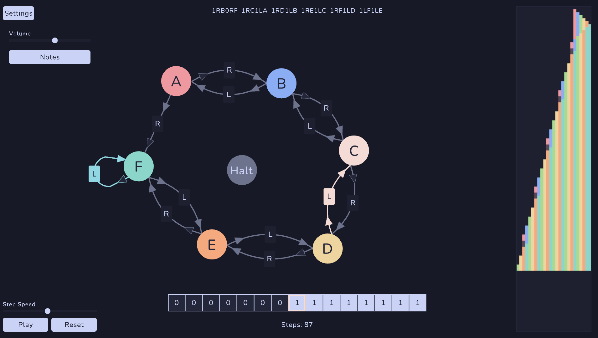 -->

## Manual

I won't cover how a Turing machine works here, you can learn about that with a quick google search or by watching Polylog's video. Instead this section will focus on how to use the editor.

###### **NOTE THE THE COLORS IN SOME GIFS ARE BROKEN. I'M UNSURE WHY BUT IT IS IRRELEVANT TO THE INFORMATION PORTRAYED!**

### Startup and Arguments

The program can be started like any other.  
Additionally, Turing Factory takes two command line arguments:
- `debug` : Displays the debug info on the top left corner of the window.
- `[BB standard machine format string]` : Starts the program with an existing machine built from the official BB format for Turing machines.

A quick breakdown of the BB format:


Example command:

```sh
./turingfactory debug 1RB1RD_1LC0RC_1RA1LD_0RE0LB_0RZ1RC
```

(Will launch with the `1RB1RD_1LC0RC_1RA1LD_0RE0LB_0RZ1RC` machine loaded and with the debug text displayed.)

If started directly or with no arguments, the program will start with a single-state machine where both 0 and 1 transition to the halt state.

### State Transition Diagram Editor

To edit or build you can use the editor controls in the program itself.

You can pan and zoom the workspace view using the scroll wheel and middle mouse button.

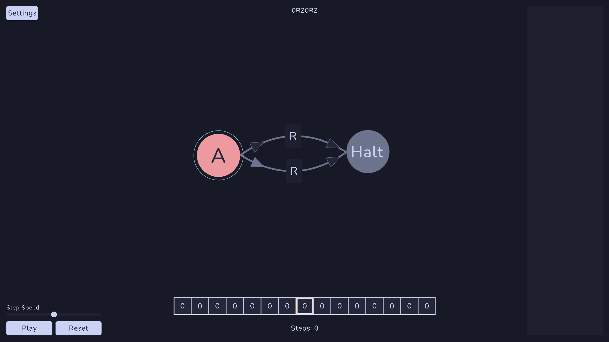

Double-click anywhere to create a new state. You can add states from A to Y (Z is reserved for the Halt state).

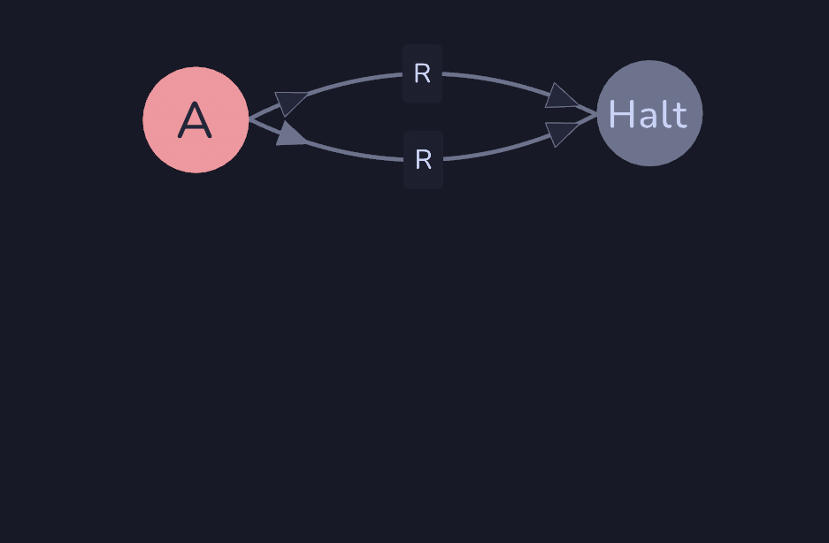

You can rearrange the states however you want by left clicking and dragging them around the workspace.

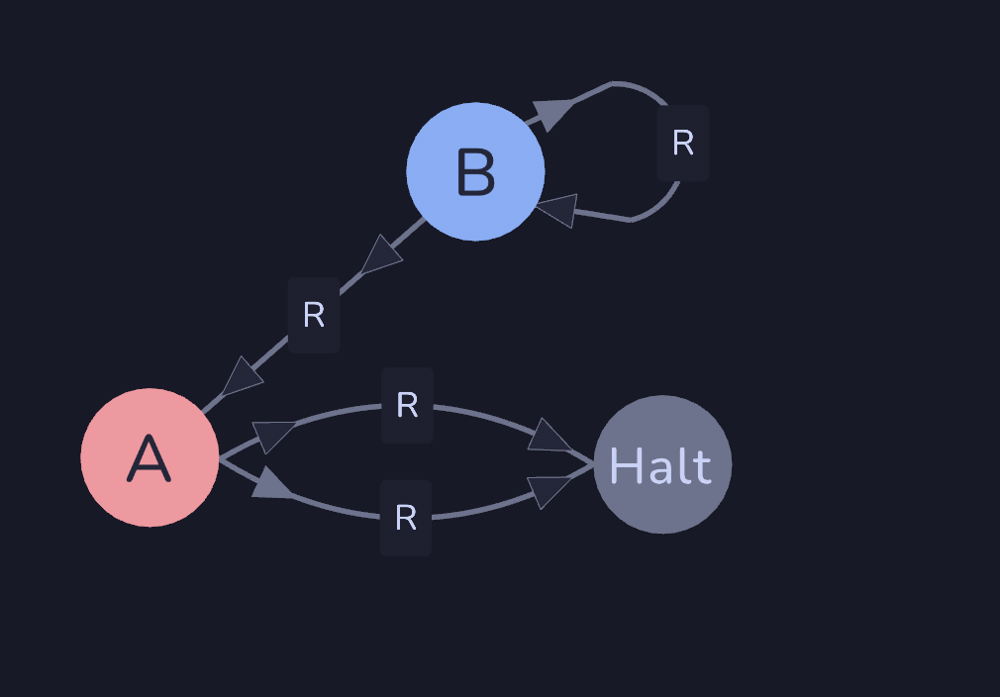

To connect states, right click and drag from the origin state to the destination state, letting go over it.  
If you want to connect a state to itself, right click and drag, keeping the mouse inside the origin state itself. Every state **must** have transitions for both 0 and 1 reads, even if one of those will never mathematically happen. You are not obligated to transition to the Halt node.

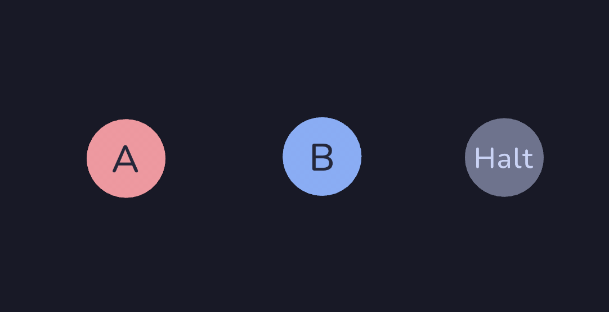

State transition lines are fixed and calculated based on proximity and angle. Self-loops however, can be rotated around the state circle by left clicking and dragging on the loop line (not on the L/R label or the read/write arrows!) once it is selected. **For the rotating to happen, the connection must already be selected.**

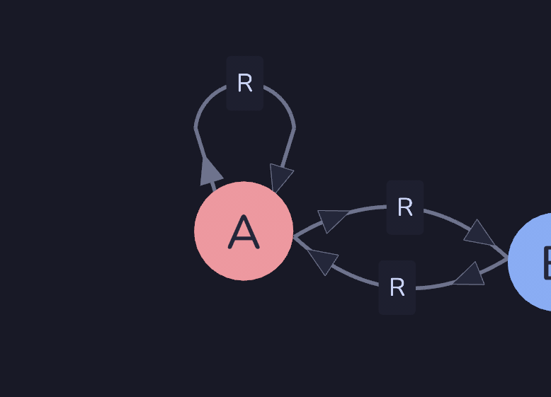

You can delete states or transitions by selecting them and pressing the delete key. If you delete a state with transitions, those transitions will be deleted too.

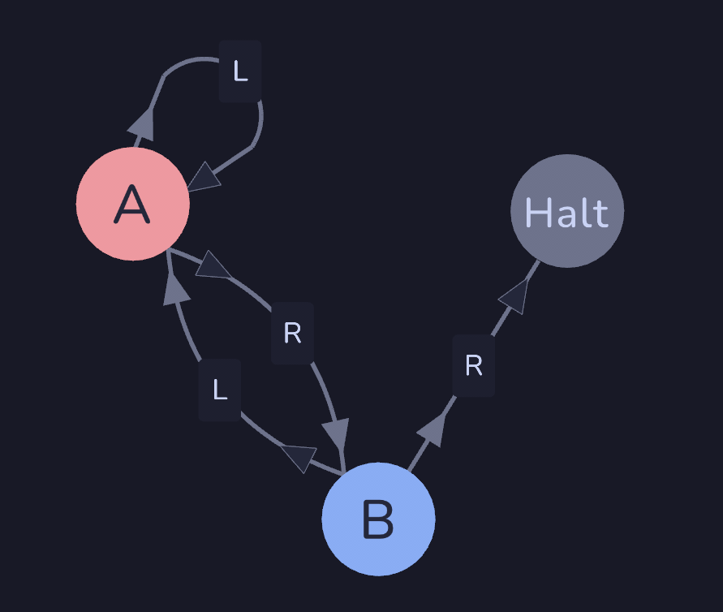

To change the transition direction and read/write values, simply left click on them.

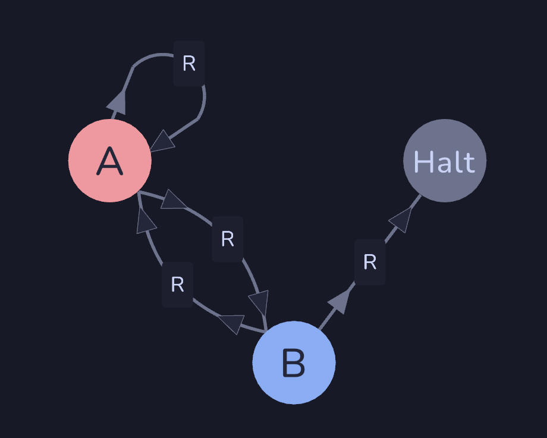

Since the read values are strictly enforced per state, switching the read value on a transition which already has both 0 and 1 transitions will automatically swap the read values between those two transitions. Note that, if the transitions are exactly the same, switching is meaningless and will have no effect at all.

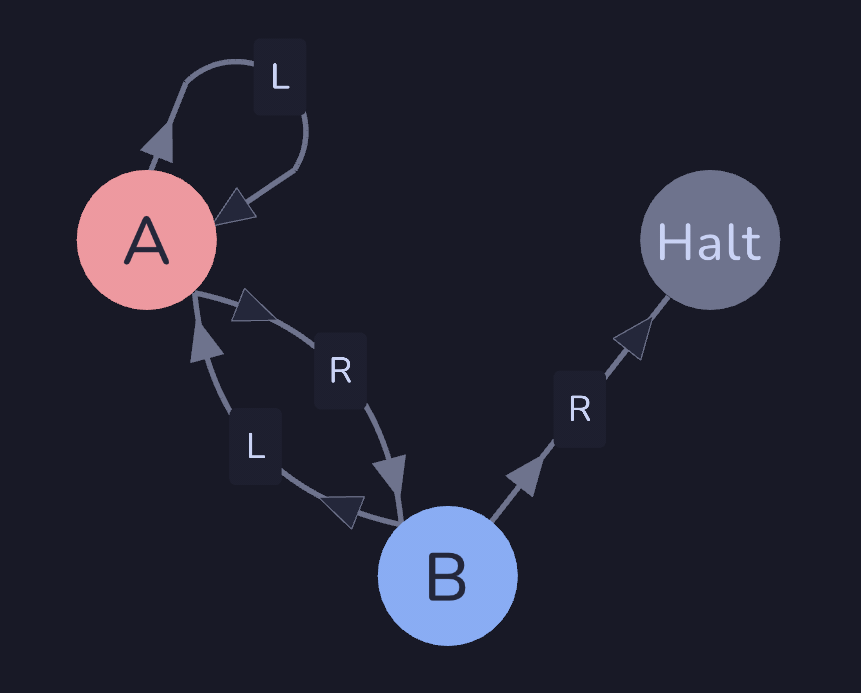

Finally, the text at the top of the window which displays the BB format string of the current machine can be edited by clicking on it and typing. All regular requirements still apply of course. If you delete a state which has some existing transitions, unlike doing so in the editor, it will not automatically delete those transitions, since you are directly altering the definition string character by character. **This can lead to new states being already linked to other states as per the old transition data in the definition!** _This is not a bug._

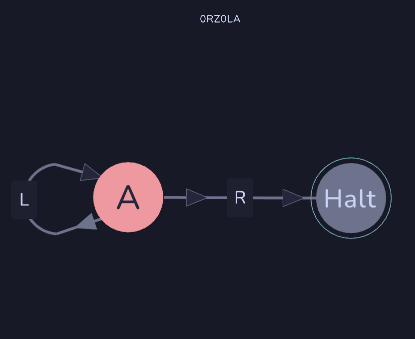

To stop editing the definition string, press the escape key.

Note that, holding down backspace will not retrigger the delete key, you must press it per character. This may be changed in the future but was not a priority during development, as this definition editing is a secondary feature mostly for **pasting existing definitions directly into the program with Ctrl+V.**

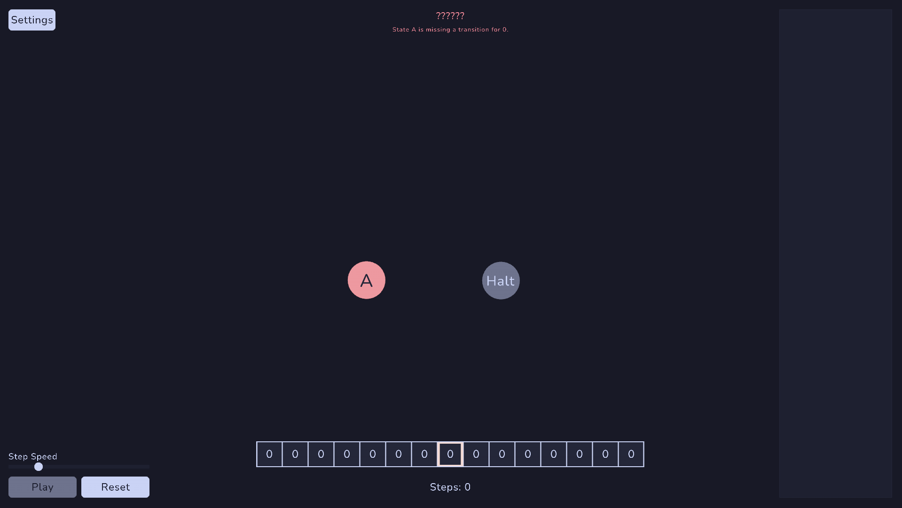

### Playback Controls

You can play and pause the simulation once the machine is validated and accepted. This can be done either using the button on the bottom left or pressing the spacebar. The Reset button resets the machine back to step 0.

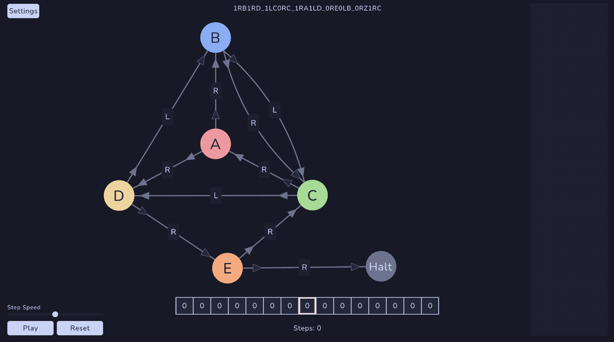

The speed slider controls the time it takes for a step of the machine to complete. The lowest speed is exactly one step per second and the speed scales logarithmically up to about 40 steps per second.

You can see the tape movement and values directly in the tape visualizer at the bottom of the window, as well as the tape history on the right side of the window. This history view will scale automatically to fit all the cells in the panel. The cells are colored per the state which wrote that cell, either at full opacity for a 1 and about a third opacity for a 0.

Note: The history view individually renders all cells, so as the step count increases so does the memory load and rendering cost per frame. After some benchmarking, FPS starts to drop steadily after about 2000 steps on my computer. This likely varies from machine to machine and computer to computer. **Future updates may try to improve performance by optimizing the rendering.**

### Sound Controls

Currently the sound controls are in the settings menu, which can be accessed by clicking on the settings button on the top left of the window. This button shows and hides the settings. More things will be added to the settings in future updates.

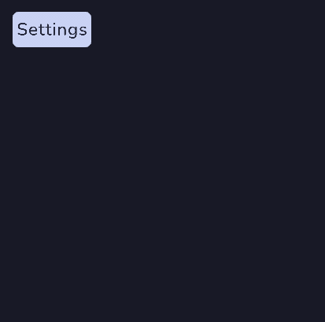

Here the sounds can be switched between notes and drums, as well as adjusting the volume with a slider.

Planned features regarding sound include: A mute button instead of just a volume slider. All notes in the 12-note scale (currently a minor scale was used, because I like how that sounds). Ability to chose what node makes what sound, effectively turning this into a full drum-machine/arpeggiator.

## Credits

All code, documentation and the note sounds - Myself

Concept and inspiration - [Polylog](https://www.youtube.com/@PolylogCS)

Graphics, sound and user interactions handled with [Raylib for C#](https://github.com/raylib-cs/raylib-cs).

Drum sounds from various free sample packs I acquired throughout the years.

Thanks to my close friends for testing on Linux and Windows computers.

---

**Turing Factory is released under the AGPL 3.0 License. Forks must use the same license.**
