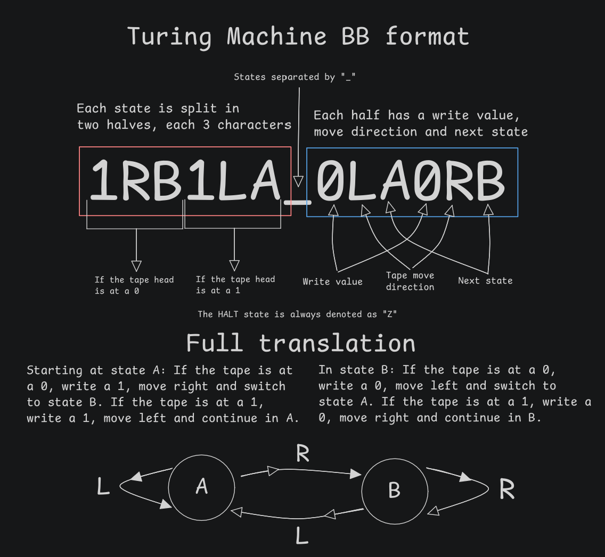

# Turing Factory (Beta 1.0)
###### by KixiK :)

Turing Factory is a Turing machine visualizer, editor, simulator and procedural music tool...? That last one is more of an extra.
This project was inspired by the visuals in the video [BB(5) = 47,176,870](https://youtu.be/kMHCl2PGloQ?si=M3GsjeBK1Th8AWXs) by the amazing YouTube channel [Polylog](https://www.youtube.com/@PolylogCS). Please go check them out!

## Manual

I won't cover how a turing machine works here, you can learn about that with a quick google search or by watching Polylog's video. Instead this section will focus on how to use the editor.

Turing Factory takes two command line arguments:
- `debug` : Displays the debug info on the top left corner of the window.
- `[BB standard machine format string]` : Starts the program with an existing machine built from the official BB format for Turing machines.

A quick breakdown of the BB format:

By default the program will start with a single-state machine where both 0 and 1 link to the halt state.

**MORE SOON, THIS IS A WIP.**
